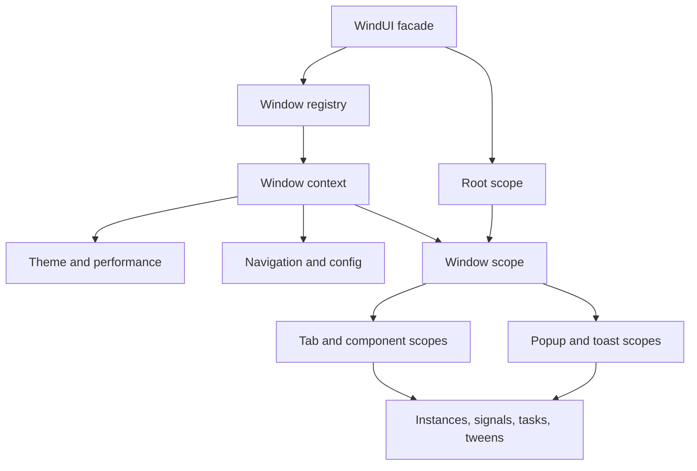

# Kiến trúc và ownership

`Scope` giữ context theo coroutine, không dùng một biến Current chung khi callback yield. Creator.New/AddSignal/Tween và task wrapper gắn ownership vào scope đang chạy. Các method public của Window/Tab/component được bind trở lại owner. Cleanup hủy child trước, chặn callback mới và thực hiện tiếp dù một cleanup bị lỗi. Instance.Destroying loại bỏ theme/font/localization/shape binding; tween cạnh tranh cùng property bị hủy. Các trạng thái logic không chờ tween completed.

Registry cửa sổ có ID đặt trước cả lúc KeySystem đang chờ. Mỗi context sở hữu ScreenGui, DropdownGui, TooltipGui và UIScale. TabModule và ConfigManager được tạo theo Window. Root còn sống khi một Window bị hủy. Input capture có token; owner hủy thì trả token. Popup được phối hợp theo Window; z-order của GUI và notification được điều chỉnh theo focus.

ConfigManager giữ parser/schema tương thích. Storage tách Memory/File/custom; namespace tách Window và profile. Dữ liệu hỏng không bị Save tự ghi đè. Tự lưu chỉ chạy khi được bật, debounce theo thay đổi thực tế, bị hủy lúc Window bị hủy.

ThemeEngine biến token thành flat theme để Creator và theme cũ tiếp tục hoạt động. Theme update đổi property của instance hiện có; không rebuild control, không xóa value hoặc search entry. Style là opt-in. Glass mặc định dùng bề mặt trong suốt của native GUI. Acrylic nâng cao chỉ giữ DOF riêng của WindUI và không đổi Enabled của DOF game khác. Phần này vẫn cần kiểm tra hiển thị thật trong game có post-processing.

Component và icon pack dùng lazy factory. IconAdapter dùng nội dung submodule đã checkout thay vì tải và chạy một module icon qua HTTP lúc bootstrap. Notification và popup không dùng module từ URL. Custom components/commands chỉ thực thi callback ứng dụng đăng ký.

DataTable/TreeView và các danh sách overlay dùng VirtualList: chỉ tạo số button đủ viewport cộng phần dư nhỏ, cập nhật qua CanvasPosition/AbsoluteSize. Dữ liệu gốc vẫn nằm trong model để sort/filter/selection ổn định. Các control thông thường không được tự động virtualize, vì callback/GUI Instance của API cũ có thể được script truy cập trực tiếp.

## Tệp entry và bản quyền

- `src/Init.lua`: input build production; `dist/main.lua`: bundle sinh tự động.
- `main.client.lua`: ví dụ cũ giữ nguyên; không coi việc compile là đã chạy ví dụ này trong Roblox.
- `main_example.lua`, `main.lua`: entry/reference cũ giữ nguyên.
- `tests/fluent/Gallery.lua`, `Studio.client.lua`, `studio.project.json`: gallery native và cách đóng gói Studio mới.
- `LICENSE`, notices Fluent/Dawid và giấy phép MIT của adapter icon được giữ. Không thêm asset Windows độc quyền. Asset Roblox hiện hữu tiếp tục chịu điều kiện truy cập của Roblox và giấy phép nguồn tương ứng.

## Build và CI

Build dùng `set -euo pipefail`, xử lý lỗi DarkLua và đọc metadata bằng Node argv thay vì nhúng JSON vào mã shell. Ngày build lấy từ SOURCE_DATE_EPOCH hoặc commit để có thể tái tạo; khi build ZIP không có Git, mặc định dùng thời điểm build. Đặt SOURCE_DATE_EPOCH để tái tạo đúng ngày bundle trong báo cáo. Workflow main chỉ build/test/upload artifact, quyền contents:read; đã bỏ bước tự commit/push. Workflow PR không còn continue-on-error, pipeline dùng pipefail và chạy npm test. Workflow release cũ không bị kích hoạt; không tạo tag/release.

## Rollback

Nhánh nâng cấp dựa trên `d2c9bac5f96f997418d680d19cb759892542e492`. Có thể checkout commit này và checkout recursive submodule để quay về source gốc; không cần đổi tên API. Với script đang dùng theme cũ, bỏ các option Style/Layout mới. Giữ backup file config trước khi chuyển nhánh; schema hiện tại không nâng version ngoài 1.2. Dữ liệu flag mới không có parser trong bản cũ sẽ không được bản cũ áp dụng.

Không force-push hoặc thay đổi nhánh main khi rollback thử nghiệm. Git bundle trong gói bàn giao giữ nhánh nâng cấp và lịch sử cần thiết để khôi phục repository khi chưa push được.
